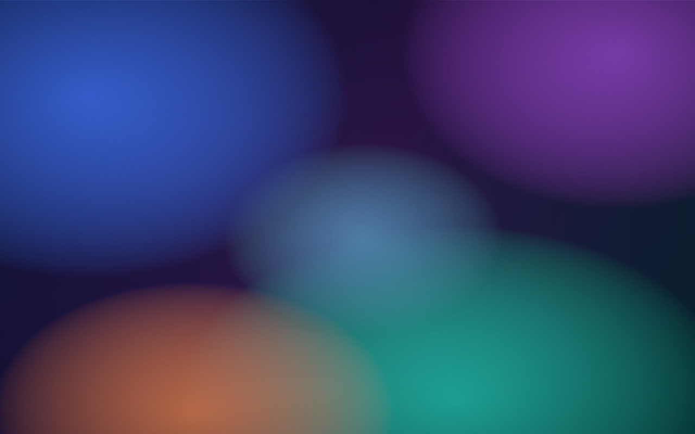
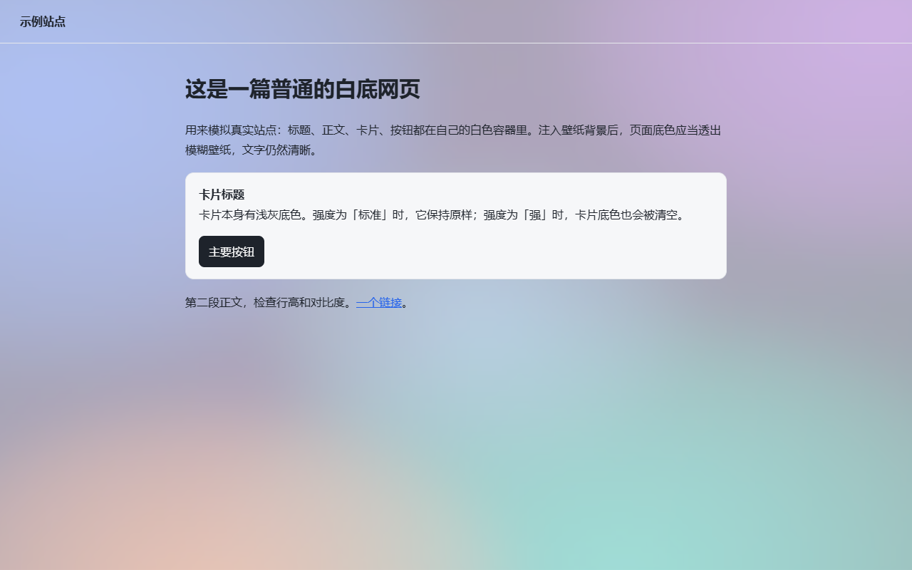

# Acrylic Wallpaper

把一张壁纸变成整个浏览器的背景：新标签页是原图，所有网站是同一张图的磨砂版，跟着页面明暗自动切换。



## 它做什么

- **新标签页**：壁纸铺满，没有搜索框、没有快捷网站、没有文字。
- **所有网站**：壁纸重度模糊后垫在页面下方，网页自己的底色被清空，于是每篇文章、每个列表都浮在同一块毛玻璃上。
- **明暗自适应**：默认按页面正文颜色选蒙版（白底站点走浅色，深色站点走深色），也可以改成跟随系统。
- **可控**：工具栏弹窗里有总开关、三档强度、按站点禁用。



## 安装（开发版）

1. 地址栏打开 `edge://extensions`（或 `chrome://extensions`）。
2. 打开「开发人员模式」。
3. 点「加载解压缩的扩展」，选择本仓库根目录。
4. 已打开的标签页刷新一次才会注入背景。

> 商店版本发布后可以直接从 Edge 加载项商店 / Chrome 应用商店安装，见下方「商店」。

## 用法

点工具栏图标：

| 项 | 说明 |
| --- | --- |
| 在网站上启用 | 总开关。关掉后所有站点恢复原样，新标签页不受影响。 |
| 强度 | 轻：只清 `html`/`body`；标准：再清常见外层容器；强：清所有元素的背景色。 |
| 明暗 | 跟随页面（默认，按正文颜色）／ 跟随系统。 |
| 禁用本站 / 恢复本站 | 个别站点结构特殊时单独关掉。 |

## 换成你自己的壁纸

仓库里的 `wallpaper.jpg` 是程序生成的抽象图，随便用。想换成自己的照片：

```powershell
pwsh -File scripts/set-wallpaper.ps1 -Image "D:\pictures\my-wallpaper.jpg"
```

脚本会生成 `wallpaper.jpg`（2560 宽）和 `wallpaper-blur.jpg`（1280 宽预模糊），并重建 `icons/`。然后到扩展页点「重新加载」。

不想用 PowerShell 的话，手动替换同名文件也可以：`wallpaper.jpg` 尽量 2560×1440 左右，`wallpaper-blur.jpg` 用同图缩到 1280 宽再放大到模糊。

## 目录

```
manifest.json         MV3 清单
newtab.html/css       新标签页（纯壁纸）
content.js            注入模糊壁纸、清空页面底色、选择明暗
popup.html/css/js     工具栏弹窗与设置
wallpaper.jpg         原图
wallpaper-blur.jpg    预模糊图
icons/                16/32/48/128
scripts/              生成壁纸、打包 ZIP
store/                商店文案与截图
```

## 隐私

不收集任何数据，不联网，不上传截图或网址。设置只存在 `chrome.storage.sync`（浏览器自带的同步存储）。详见 [PRIVACY.md](PRIVACY.md)。

权限说明：

- `storage`：保存开关、强度、禁用名单。
- `tabs`：弹窗读取当前标签的域名，用来显示「本站禁用」。
- `<all_urls>`：内容脚本需要在每个网站注入背景样式。

## 已知边界

- 只能改网页本身，改不了地址栏、标签栏这些浏览器外壳。
- 部分站点把白色底色写在行内样式或 `!important` 上，可能顶住少数元素；用「强」或「禁用本站」兜底。
- 页面里 iframe 的内容不注入。
- 站点自带深色主题时，「跟随页面」会自动切深色蒙版。

## 商店

- Edge 加载项：见 [store/listing.zh.md](store/listing.zh.md) 的提交信息。
- Chrome 应用商店：同上，另需一次性 5 美元的开发者注册费。

## 许可

代码与仓库内的壁纸、图标、截图为 [MIT](LICENSE)。第三方壁纸不属于本仓库，替换后请自行确认版权。

## English

Acrylic Wallpaper turns one wallpaper into the browser backdrop: a clean full-bleed new tab, and a blurred version behind every website with page-local light/dark detection. No data collection, no network requests. Load the folder as an unpacked extension (Edge/Chrome developer mode), or use `scripts/set-wallpaper.ps1` to swap in your own picture. MIT licensed.

